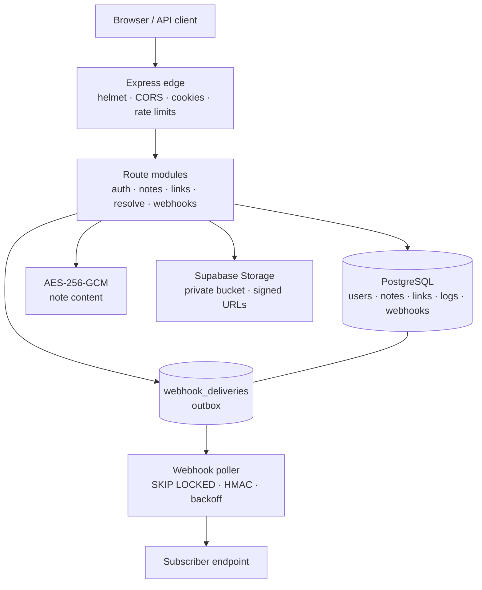
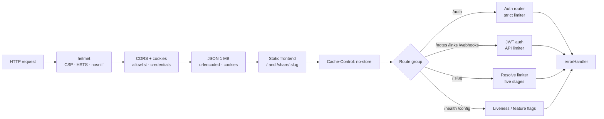
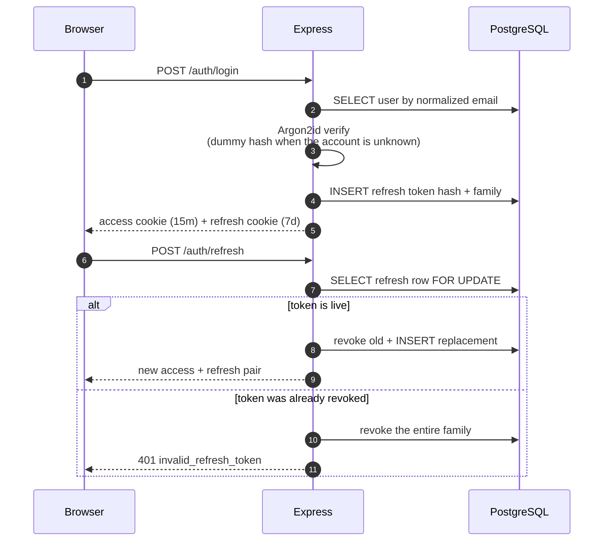
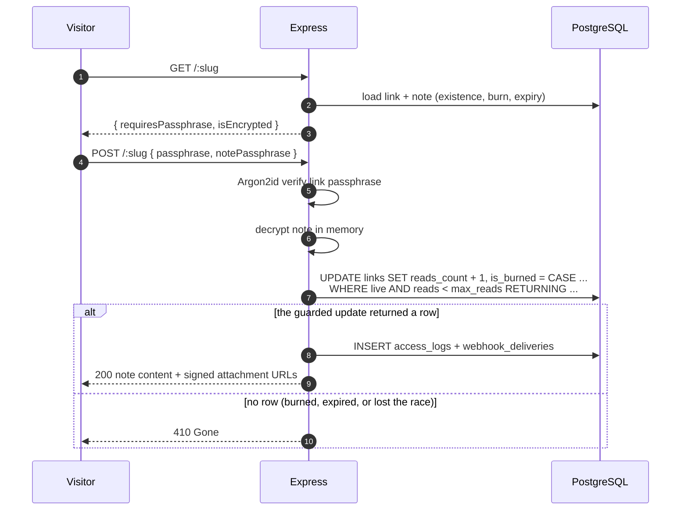
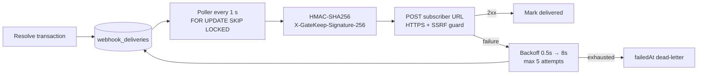

# GateKeep

> **Encrypted Ephemeral Content Sharing Engine** — encrypted notes, passphrase-gated share links, atomic read limits, signed webhooks, and compound-indexed analytics.

[Live app](https://gatekeep-6lhv.onrender.com) · [Health check](https://gatekeep-6lhv.onrender.com/health) · [Case study](https://itsgintoki.github.io/web/work/gatekeep.html) · [Source](https://github.com/itsgintoki/gatekeep)

**Stack:** Node.js 22 · TypeScript · Express 5 · PostgreSQL + Drizzle · Supabase Storage · Docker · Render
**Tests:** 24 unit + 8 integration (Node test runner, real PostgreSQL)

## Contents

- [What it is](#what-it-is)
- [Browser app](#browser-app)
- [Architecture](#architecture)
- [Security model](#security-model)
- [Quickstart](#quickstart)
- [Testing](#testing)
- [Repository map](#repository-map)
- [Deployment](#deployment)
- [Limitations and next steps](#limitations-and-next-steps)
- [API reference](#api-reference)
- [License](#license)

## What it is

GateKeep is a sharing engine for notes that should not live forever. A note starts private. The owner can publish it through a share link with an optional passphrase, an expiry date, and a maximum number of reads. Once the limit is reached or the deadline passes, the link is done.

The interesting part is not the editor. It is making that promise hold when two people open the last read at once, when a client retries, when storage is slow, and when someone tries to guess a passphrase. The database owns the counter; the browser never does.

- **Encrypted at rest:** note content is AES-256-GCM encrypted with `scrypt` key derivation. Plaintext is not stored in PostgreSQL, but the API receives plaintext and passphrases while encrypting or decrypting.
- **Atomic burn-on-read:** a single guarded `UPDATE ... RETURNING` is the compare-and-swap. A loser of the race gets `410 Gone`, not a second read.
- **Five-stage resolve pipeline:** existence → burn state → expiry → passphrase → atomic consume. Decryption happens before the counter moves, so a wrong note passphrase never burns a read.
- **Private files:** attachments live in a private Supabase bucket and are released only through short-lived signed URLs.
- **Signed webhooks:** `link.accessed` / `link.burned` events go through a durable outbox, HMAC signatures, retries, and a dead-letter state.
- **Analytics without leaking contacts:** aggregate views, devices, browsers, referrers, and masked visitor IPs.

## Browser app

Open `/` for the GateKeep workspace. The frontend uses a cream, ink, orange, and monospace visual style, with responsive layouts and a dark theme.

- Sign up and sign in, then create, edit, encrypt, unlock, and delete notes.
- Search note titles, pin notes, autosave existing notes, duplicate content, export Markdown, and see word counts and reading time.
- Manage attachments, sharing links, expiry dates, passphrases, and read limits. Copy links or display their QR codes.
- Inspect each link's status and access analytics, and manage webhook destinations.
- Copy a `/share/:slug` URL for recipients. Loading the page checks availability only; a read is consumed when the recipient explicitly submits **Open note**.
- Shortcuts: `Ctrl/⌘ + S` save, `N` new, `P` pin, `D` duplicate, `K` copy link. The **?** menu also offers logout from all sessions.

Notes are private until a link is created. New notes need an initial manual save; existing notes autosave after 1.5 seconds unless encryption settings are changing. Duplicates copy content without attachments or links. Uploads support JPEG, PNG, GIF, WebP, PDF, Word, MP4, WebM, Ogg, and MOV up to 30 MB. Shared pages preview images, PDFs, and video after successful access; other files open through a download link.

A note's encryption passphrase and a link's access passphrase are separate. If both are set, the recipient needs both. Incorrect passphrases do not consume a read. Note encryption happens on the server; it is encryption at rest, not end-to-end encryption. Files are held in a private bucket and are not encrypted by the note passphrase. Owners and successful recipients receive signed URLs that expire after 15 minutes. A downloaded copy remains with its recipient, and an issued URL remains usable until expiry even after the link burns.

The app uses httpOnly session cookies. Only the theme preference is stored in localStorage; note content, passphrases, and tokens are not. The frontend and API share one Express origin and one deployment, with no separate frontend framework or service.

## Architecture

### System context



The API owns expiry, passphrase verification, read counters, file authorization, and analytics. PostgreSQL is the source of truth; Supabase Storage holds bytes; Redis is not required. The browser only receives what it needs for the current request.

### Request pipeline



Order matters: `/auth` is mounted before `/:slug` so a slug cannot shadow an API route; `errorHandler` is last so `next(err)` reaches it. `TRUST_PROXY` must match the host's hop count, because `req.ip` drives rate limits and access logs.

### Authentication and refresh rotation



Access tokens are stateless 15-minute JWTs; refresh tokens are opaque, stored only as SHA-256 hashes, and single-use. Replaying a consumed refresh token revokes the family.

### Resolve and atomic burn



The compare-and-swap in the `WHERE` clause is the concurrency guarantee: exactly one request can consume the last read. Decryption is deliberately before `consumeLink`, so a typo in `notePassphrase` never spends a read.

### Webhook outbox



The resolve transaction only inserts delivery rows; it never waits on a subscriber. The poller claims work with `SKIP LOCKED`, signs the exact body, and retries with exponential backoff. A stale claim (`lockedAt` older than 5 minutes) is reclaimable after a crash.

### Data model

```mermaid
erDiagram
    users ||--o{ notes : owns
    users ||--o{ webhooks : registers
    users ||--o{ refresh_tokens : rotates
    notes ||--o{ attachments : has
    notes ||--o{ links : shares
    links ||--o{ access_logs : records
    webhooks ||--o{ webhook_deliveries : emits

    users {
        uuid id PK
        text email
        text password_hash
    }
    notes {
        uuid id PK
        uuid user_id FK
        text title
        text content
        boolean is_encrypted
        boolean is_pinned
        timestamptz deleted_at
    }
    links {
        uuid id PK
        uuid note_id FK
        text slug
        integer max_reads
        integer reads_count
        boolean is_burned
        timestamptz expires_at
    }
    attachments {
        uuid id PK
        uuid note_id FK
        text storage_path
        text mime_type
        integer size_bytes
    }
    access_logs {
        uuid id PK
        uuid link_id FK
        text ip
        text user_agent
        timestamptz accessed_at
    }
    webhooks {
        uuid id PK
        uuid user_id FK
        text url
        text secret
    }
    webhook_deliveries {
        uuid id PK
        uuid webhook_id FK
        text event
        integer attempts
        timestamptz delivered_at
        timestamptz failed_at
    }
    refresh_tokens {
        uuid id PK
        uuid user_id FK
        text token_hash
        timestamptz expires_at
        boolean is_revoked
    }
```



## Security model

| Boundary | Control |
| --- | --- |
| Passwords | Argon2id (64 MB, 3 passes); constant dummy-hash verification for unknown emails |
| Sessions | 15-minute stateless access JWT; 7-day rotating refresh token stored as SHA-256; family revocation on replay |
| Note content | AES-256-GCM with scrypt KDF and a fresh salt/IV per encryption; server-side, not end-to-end |
| Files | Private Supabase bucket; 15-minute signed URLs; 30 MB cap; MIME allowlist; no public object URLs |
| Share links | Base62 slug; optional passphrase, expiry, and read limit; atomic compare-and-swap consume |
| Webhooks | HTTPS-only, embedded-credential rejection, private/reserved IP blocking, DNS re-validation at connect, HMAC signature, capped retries |
| Abuse | Tiered sliding-window rate limits, CORS allowlist with credentials, Helmet CSP, 1 MB JSON body cap |
| Ops | Production fail-fast on placeholder secrets and the dev database password; schema-name allowlist; `/health` check |

Rate limiting is an in-memory sliding window keyed by `req.ip`. That is deliberate for a single Render instance; a multi-instance deployment needs a shared store (for example Redis) so limits are global.

## Quickstart

Requirements: Node.js 22+, Docker, and Docker Compose.

```sh
npm ci
cp .env.example .env
docker compose up -d postgres
npm run dev
```

Open `http://localhost:3000`. The dev command builds the browser TypeScript before starting the server; migrations run on boot. During frontend work, run `npm run dev:client` in a second terminal to watch TypeScript edits; HTML and CSS are served directly from `public/` in development.

`npm run build` compiles the API and browser TypeScript and copies the HTML/CSS into `dist/public/`. `npm run typecheck` checks both TypeScript projects.

Fill in the database connection and JWT secrets in `.env`. Supabase Storage credentials are optional locally: the app starts without them and disables uploads. Production cookie sessions require HTTPS. When using a reverse proxy, set `TRUST_PROXY` to its trusted hop count. Same-origin browser requests are accepted automatically; add other trusted frontend origins to `ALLOWED_ORIGINS` only when needed.

## Testing

```sh
npm run build        # required before integration tests: they serve dist/public
npm test             # 24 unit tests
npm run test:integration   # 8 integration tests
npm run typecheck
```

The suite uses Node's built-in test runner (`node --import tsx --test`), not a separate framework. Unit tests cover encryption, Base62, note-content transitions, runtime config, user-agent parsing, the rate limiter, error handling, webhook signing/SSRF, and storage. Integration tests use PostgreSQL and cover the schema contract, ownership and tenant boundaries, cookie sessions, refresh rotation, preview-vs-consume behavior, the passphrase/decrypt/consume ordering, the QR route, and the one-time database copy CLI.

Integration tests use `DATABASE_URL`; use a dedicated test database or a throwaway `DATABASE_SCHEMA`. They create their own users and clean them up afterward.

## Repository map

```text
src/
├── app.ts                 Express pipeline and route mounting
├── index.ts               boot: config → migrations → webhook poller → listen
├── modules/
│   ├── auth/              signup/login/refresh/logout, Argon2, cookies
│   ├── notes/             CRUD, encryption transitions, attachments
│   ├── links/             share links, QR codes, analytics
│   ├── resolve/           public GET probe + POST consume (atomic burn)
│   └── webhooks/          destination registry and signed delivery
├── lib/
│   ├── crypto.ts          AES-256-GCM + scrypt
│   ├── noteContent.ts     encrypt/rotate/strip state machine
│   ├── base62.ts          bijective short-link encoding
│   ├── jwt.ts             access/refresh token signing and hashing
│   ├── storage.ts         Supabase signed URLs and object paths
│   ├── webhook.ts         HMAC signing, outbox claim, retries
│   ├── webhookHttp.ts     HTTPS/SSRF validation
│   ├── userAgent.ts       zero-dependency UA parser
│   └── runtimeConfig.ts   production secret checks
├── middleware/            authenticate, errorHandler, rateLimiter, upload
└── db/                    schema, pool, migrations, copyDatabase CLI
public/                    browser app (HTML/CSS/TypeScript)
tests/                     unit + integration suites
drizzle/                   versioned SQL migrations
NAVIGATION.md              guided, phase-by-phase code tour
```

New to the codebase? Read [`NAVIGATION.md`](./NAVIGATION.md) — it walks the request pipeline, the auth slice, the note/link/resolve path, and the production-hardening layers in order.

## Deployment

Render hosts the browser app and Express API; Supabase provides PostgreSQL and private file storage. Create a Render Blueprint from this repository using [`render.yaml`](./render.yaml). It creates one free Node.js web service, builds both TypeScript projects, generates JWT secrets, and runs migrations before listening.

Set these server-side variables in Render:

| Variable | Value |
| --- | --- |
| `DATABASE_URL` | Supabase PostgreSQL connection URI; Session pooler on IPv4-only hosts, with TLS |
| `DATABASE_SCHEMA` | `gatekeep` |
| `SUPABASE_URL` | Supabase project URL |
| `SUPABASE_SERVICE_KEY` | Supabase secret/service-role key; never sent to the browser |
| `SUPABASE_STORAGE_BUCKET` | `gatekeep` |

For verified TLS, download the certificate from the official **Database Settings** certificate link in Supabase and add it to Render as a secret file named `prod-ca-2021.crt`. Render mounts it at `/etc/secrets/prod-ca-2021.crt`; set `DATABASE_URL` to `sslmode=verify-full&sslrootcert=/etc/secrets/prod-ca-2021.crt`, replacing any existing TLS options.

Create a **private** `gatekeep` storage bucket with a 30 MB limit and the supported MIME types. Do not make the bucket public. `/config` reports whether upload credentials are configured; `/health` is the deployment health check.

GateKeep uses its own `gatekeep` schema and `gatekeep_migrations` history. It does not use Supabase Auth or expose database credentials to the frontend. Existing standalone installations can retain `DATABASE_SCHEMA=public`. Never commit secrets.

### Moving an existing database

Run the one-time transfer manually from a CLI after building the application:

```sh
DATABASE_URL='<new-database-url>' SOURCE_DATABASE_URL='<old-database-url>' node dist/db/copyDatabase.js
```

The source schema defaults to `gatekeep`. Stop writes to the old app during transfer. The command migrates an empty destination, copies records transactionally in batches, checks counts, and records completion so it cannot import twice. It refuses to overwrite a nonempty destination or copy the shared `public` schema. Keep this import out of the service startup command and remove `SOURCE_DATABASE_URL` after a successful transfer.

Existing Cloudinary attachments require a separate object migration before applying the storage migration; the migration refuses to proceed if attachment rows remain. The original hosted GateKeep instance had uploads disabled. After verifying a transfer, retire the source database.

## Limitations and next steps

- **Single-instance rate limiting.** The sliding window lives in process memory; multiple API instances need a shared store.
- **Server-side encryption, not E2E.** The API sees plaintext and passphrases while encrypting or decrypting; storage objects are not encrypted by the note passphrase.
- **No background cleanup yet.** Expired note rows and orphaned files need a scheduled cleanup job.
- **Analytics are aggregate-first.** Owners get link analytics, not a per-access audit trail.
- **No email/calendar/MFA/SSO/malware scanning.** These are production integrations, not demo features.
- **Audit logs are append-only by application convention,** not by database permissions.
- **Copy CLI streams in batches** (1,000 rows per page) inside one transaction; for very large databases, `pg_dump`/`pg_restore` is still faster.

A good next milestone is a note-owner audit trail plus a background cleanup worker, then a multi-instance rate-limit store.

## API reference

### Authentication (`/auth`)

- `POST /auth/signup` — register; returns public player details.
- `POST /auth/login` — authenticate; sets access (15m) and refresh (7d) httpOnly cookies, returns access token.
- `POST /auth/refresh` — rotate a single-use refresh token.
- `POST /auth/logout` — revoke the active refresh token.
- `POST /auth/logout-all` — revoke every refresh token for the authenticated user.
- `GET /auth/me` — inspect the authenticated session.

### Notes (`/notes` — protected)

- `POST /notes` — create; an optional passphrase encrypts the content.
- `GET /notes` — list with `page`, `limit`, and literal title `search`; pinned first.
- `GET /notes/:id` — metadata and content.
- `POST /notes/:id/decrypt` — decrypt with the note passphrase.
- `PATCH /notes/:id` — update title, content, pin state, or encryption settings.
- `DELETE /notes/:id` — soft-delete and remove Supabase objects.
- `POST /notes/:id/attachments` — upload (30 MB maximum).
- `DELETE /notes/:id/attachments/:attachmentId` — remove an attachment.

### Links and analytics (`/links` — protected)

- `POST /links` — create a Base62 link with burn-on-read, expiry, passphrase, and webhook options.
- `GET /links` — list.
- `GET /links/:id` — status and metadata.
- `GET /links/:id/qr` — authenticated SVG QR code.
- `GET /links/:id/analytics` — aggregate clicks, devices, OS, browsers, referrers.
- `DELETE /links/:id` — invalidate.

### Webhooks (`/webhooks` — protected)

- `POST /webhooks` — register an HTTPS destination; returns the HMAC secret.
- `GET /webhooks` — list (secret omitted).
- `GET /webhooks/:id` — inspect details and secret.
- `DELETE /webhooks/:id` — remove; existing links keep working but go quiet.

### Public resolution (`/:slug` — public)

- `GET /:slug` — availability and passphrase requirements; never consumes a read.
- `POST /:slug` — consume one read; optional link `passphrase` and `notePassphrase`.
- `GET /share/:slug` — browser recipient page; opening it never consumes a read.

## License

ISC
